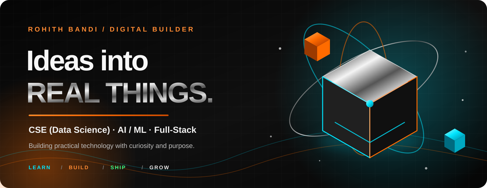

<!-- Profile README for github.com/rohitbandi0311-afk -->

  

  <h2>Hey, I'm Rohith 👋</h2>
  
<strong>Data Science Student · Developer · AI Builder</strong>

  
Exploring ideas, building useful products, and learning by shipping real projects.

  

    
    
    
  

---

## 👨‍💻 About me

- 🎓 Second-year B.Tech student in **CSE (Data Science)** at **Harita University**.
- 🤖 Interested in **AI/ML, Data Science, and Full-Stack Development**.
- 🛠️ I enjoy turning ideas into working prototypes and practical applications.
- 🌱 Currently strengthening my foundations in programming, data structures, and applied AI.
- 🤝 Open to collaborating on meaningful projects, hackathons, and learning opportunities.

## ⚡ What I work with

  

  
  
  

## 🚀 Featured projects

<table>
  <tr>
    <td width="50%" valign="top">
      <h3>🌱 <a href="https://github.com/rohitbandi0311-afk/KrishiMitra-AI">KrishiMitra AI</a></h3>
      
Multilingual crop disease screening and curated crop guidance for farmers.

      
React · TypeScript · FastAPI · LiteRT

    </td>
    <td width="50%" valign="top">
      <h3>🔔 <a href="https://github.com/rohitbandi0311-afk/AI-Message-Notification-Router-Pro">AI Message Notification Router Pro</a></h3>
      
A project exploring intelligent message and notification routing.

      
AI · Application Development

    </td>
  </tr>
  <tr>
    <td width="50%" valign="top">
      <h3>🚆 RAILOPT AI</h3>
      
AI-focused railway block planning concept developed for hackathon problem-solving.

      
AI · Optimization · Smart Mobility

    </td>
    <td width="50%" valign="top">
      <h3>💳 <a href="https://loan-prediction-system-team11.streamlit.app/">Loan Prediction System</a></h3>
      
Machine-learning application that estimates loan approval outcomes from applicant data.

      
Python · Machine Learning · Streamlit

    </td>
  </tr>
</table>

  <a href="https://github.com/rohitbandi0311-afk?tab=repositories"><strong>Explore all repositories →</strong></a>

## 🏅 Highlights

- Selected for the **Google Gemini Student Ambassador Program 2026 — Semester 2**.
- Participating in hackathons and building projects around real-world problem statements.
- Continuously learning through hands-on development and technical communities.

## 📊 GitHub at a glance

  
  

  

## 🐍 Contribution journey

  <picture>
    <source media="(prefers-color-scheme: dark)" srcset="https://raw.githubusercontent.com/rohitbandi0311-afk/rohitbandi0311-afk/output/github-snake-dark.svg" />
    <source media="(prefers-color-scheme: light)" srcset="https://raw.githubusercontent.com/rohitbandi0311-afk/rohitbandi0311-afk/output/github-snake.svg" />
    
  </picture>

## 🤝 Let's connect

  
  
  

   
  <h3>“Learn continuously. Build intentionally. Share generously.”</h3>
  Thanks for visiting my corner of GitHub ✨

